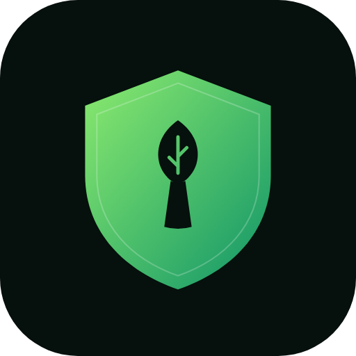

<div align="center">



# LockLeaf

**A private, zero-knowledge password manager for Android.**
Your vault is encrypted on your device. Your master password never leaves it.

[](https://github.com/jayantshringi/LockLeaf/actions/workflows/ci.yml)
[](https://github.com/jayantshringi/LockLeaf/releases/latest)
[](LICENSE)
[](#download--install)

</div>

<!-- Add 3–4 screenshots here (unlock, vault list, entry, generator) -->

## Features

- 🔐 **Encrypted vault:** logins, cards, secure notes and identities, encrypted on-device.
- ⚡ **Biometric unlock:** fingerprint or face unlock, with master-password fallback.
- 🕒 **Built-in authenticator:** TOTP codes (SHA-1/256/512) with `otpauth://` import.
- 🎲 **Generators and audit:** random passwords, offline Diceware passphrases, and a local weak/reused-password check. Nothing is sent anywhere.
- 💾 **Encrypted backups:** portable `.llbak` files, plus an offline recovery key.
- 🔄 **Optional sync:** ciphertext-only, over HTTPS, with your own compatible server.
- 🛡️ **Privacy protections:** auto-lock, clipboard auto-clear after 30 s, screenshot and task-switcher blocking, and login lockout after repeated failures.

## Download & Install

1. Open the [**latest release**](https://github.com/jayantshringi/LockLeaf/releases/latest).
2. Download the APK for your phone. Choose **`arm64-v8a`** for almost every modern device. Use `armeabi-v7a` only for older 32-bit phones.
3. Open the file and, if Android asks, allow installs from your browser or file manager.
4. Launch LockLeaf and create your master password.

**Requirements:** Android 7.0 or later. To update, install the newer APK over the old one; your data is kept.

> LockLeaf is distributed only through GitHub Releases, not the Play Store, so Android or Play Protect may show an "unknown source" notice. That is expected for apps installed this way.

<details>
<summary><b>Advanced: verify your download</b></summary>

<br>

Every release includes a `SHA256SUMS.txt` file and lists the signing certificate's SHA-256 fingerprint in its release notes.

```bash
# 1. Check the file hasn't been altered
sha256sum -c SHA256SUMS.txt

# 2. Check who signed it (requires Android SDK build-tools)
apksigner verify --print-certs LockLeaf-<tag>-arm64-v8a.apk
```

The certificate SHA-256 printed in step 2 must match the fingerprint in the release notes.

To get update notifications, you can track this repository with [Obtainium](https://github.com/ImranR98/Obtainium).

</details>

## Security

- **Key derivation:** Argon2id (64 MiB memory, 3 iterations, 4 lanes) turns your master password into the vault key on your device.
- **Encryption:** authenticated encryption with **XChaCha20-Poly1305** (default) or **AES-256-GCM**, with a fresh random nonce for every item.
- **Key storage:** biometric unlock uses a key held in the Android Keystore.
- **Zero-knowledge sync:** a sync server only ever receives encrypted records.
- **No custom crypto:** all primitives come from the [`cryptography`](https://pub.dev/packages/cryptography) package.

<details>
<summary><b>How it works</b></summary>

```text
Master password
   └─ Argon2id (salt) ─► Master key
                           ├─ HKDF ─► vault & sync subkeys ─► AEAD encryption ─► encrypted SQLite
                           └─ AES-256 key wrap ─► Android Keystore (biometric unlock)

Sync (optional): encrypted records only ─► your server
```

</details>

### Limitations

- **Not independently audited.** LockLeaf uses well-established algorithms through vetted libraries, but no third-party firm has reviewed the code. Please review it yourself before trusting it with critical accounts.
- **A compromised phone is not protected.** Malware, root access or a keylogger can capture your master password or decrypted data. Memory clearing is best-effort and cannot be guaranteed in Dart.
- **No recovery without your credentials.** If you lose both your master password and your recovery key, your data cannot be recovered. This is by design.

Found a vulnerability? Please report it privately. See [SECURITY.md](SECURITY.md).

## Contributing

Contributions are welcome. Developer setup, build instructions and coding rules are in [CONTRIBUTING.md](CONTRIBUTING.md).

## License

Released under the [MIT License](LICENSE).
